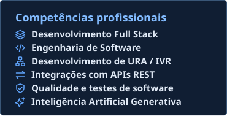

<h1 align="center">Samuel Silva</h1>

<strong>Desenvolvimento Full Stack · Engenharia de Software</strong>

  Sou Samuel de Jesus Silva Ferreira, assistente de desenvolvimento em URA na <strong>NOOVI Cloud Experience</strong>.
  Desenvolvo e mantenho fluxos de atendimento, implemento regras de negócio e integro APIs REST usando JSON.
  Faço testes funcionais e escrevo a documentação técnica.

  Curso Engenharia de Software na Anhanguera. Tenho formação técnica em Informática e fiz o bootcamp Desenvolvedor Full Stack Java da Generation Brasil.

  &nbsp;
  &nbsp;

  
  

<h2 align="center">Tecnologias</h2>

  
  

<h3 align="center">Plataformas de Customer Experience</h3>

  
  

<h3 align="center">Conhecimentos complementares</h3>

  APIs REST · JSON · Desenvolvimento de URA/IVR · Testes funcionais · Inteligência Artificial Generativa

